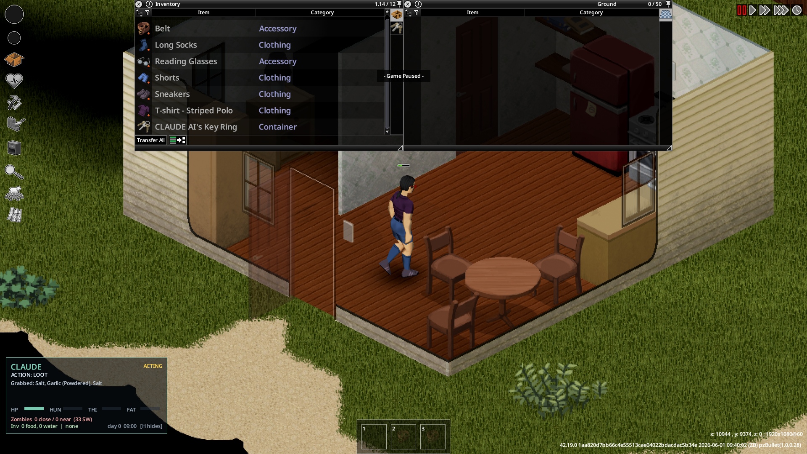

> **Laboratory fork update:** the installed Lua now starts disarmed. The bridge
> defaults to observation only; explicitly set `PZ_LAB_ARM=1` to arm it.
> `PZ_RUN_MODE=continuous` has no duration or decision limit; the default `lab`
> mode is capped at ten provider attempts and 300 seconds. Any key or mouse input
> permanently revokes that session; there is no idle auto-resume. Movement
> momentum and automatic game-speed changes are disabled. Read
> [the current lab protocol and startup instructions](bridge/README.md) before
> using the older upstream feature descriptions below. An isolated B42.21 multiplayer
> test observed looting and screwdriver equip. A subsequent scripted check of the
> current body collected three food items and consumed one with a measured hunger
> decrease; positive drinking and combat remain unverified. The current update
> prioritizes safe food and pure water, omits junk fallback, and reports
> inventory/needs evidence for LOOT/EAT/DRINK. See [lab results](docs/LAB-PLAYTEST.md).
>
> **Offline survival update:** `survival-1` adds complete/partial injury facts,
> native-action busy state and conservative adjacent window traversal. BREAKIN
> never smashes or walks to a window. These changes have fixture coverage and
> source review; their actual multiplayer behavior still needs validation.
>
> **Offline water update:** the current `water-1` body adds `DRINKTAP` and
> `FILLBOTTLE` for supported clean local piped fixtures. A task approaches,
> rechecks actual reach and safety, queues a native server-driven action and
> waits for measured thirst or same-vessel water changes. Unknown/external
> plumbing, mixtures and unsafe/foreign vessels are refused. Native multiplayer
> reconstruction, replication and interruption remain unverified. No healing or
> persistent navigation has been added.

<div align="center">

# 🧟 Claude Survives

### An AI that actually *plays* Project Zomboid — perceiving the living world, deciding with a large language model, and driving a survivor's body in real time.

[](https://projectzomboid.com/)
[](LICENSE)
[](https://nodejs.org/)
[](https://www.anthropic.com/)

*You watch a survivor wake up in Knox County with nothing. What happens next isn't scripted — an AI is living it, one decision at a time.*

</div>



---

## What is this?

**Claude Survives** hands control of a Project Zomboid survivor to a large language model. The AI sees the real running game — its vitals, the zombies around it, the buildings, the loot — thinks in character, and drives the body. It loots, fights, flees, hides, and eventually dies, and you watch the whole thing happen with its **live thoughts on screen**.

It is **not** a bot with hard-coded routines. The strategy is genuinely reasoned turn by turn. What *is* hard-coded is a fast **survival reflex layer** — because no LLM can dodge a lunging zombie in the half-second it takes to think. That split is the whole design (see [Architecture](#architecture)).

> This is a research toy and a fun thing to watch, not a competitive bot. Every run is different. Most of them end badly. That's the point.

## Features

- 🧠 **Real LLM control** — Claude authors every strategic decision (where to go, what to loot, when to hide) from a live perception feed.
- ⚡ **Local survival reflex** — sub-second fight-or-flee that keeps the body alive between the AI's slower thoughts: repulsion-vector evasion, melee against lone attackers, door-closing.
- 👁️ **Full visual transparency** — an in-game HUD shows the AI's current action, live inner monologue, vitals, zombie proximity, and inventory. It speaks its decisions aloud in speech bubbles and visibly scans its surroundings.
- 🗺️ **Situational awareness** — senses nearby buildings (so it heads for loot, not into the endless forest), tracks threats with its gaze, and knows the time of day.
- 🎮 **You can jump in** — press a key or click to permanently disarm the current lab session.
- ⏩ **Smart game-speed** — disabled in this fork to preserve multiplayer game speed.
- 🌐 **Web dashboard** — watch its mind at `localhost:8799/mind`, and text it like a voice from beyond.

## How it works (30 seconds)

```
Project Zomboid  ──writes senses──▶  Zomboid/Lua/claude_percept.json
   (ClaudeSurvivor mod, Lua)   ◀──reads intent──  Zomboid/Lua/claude_intent.txt
                                          ▲
                                          │
                          bridge/pz-bridge.mjs  (Node)
                          reads senses → asks Claude → writes intent
                          + serves the live dashboard at :8799
```

The game and the brain talk through two small files in your Zomboid folder. The mod is ~640 lines of Lua; the brain is one Node script. No servers, no database, all local.

## Quick start

**Requirements:** [Project Zomboid](https://store.steampowered.com/app/108600/Project_Zomboid/) **Build 42**, [Node.js 18+](https://nodejs.org/), and a working [`claude` CLI](https://docs.claude.com/en/docs/claude-code/overview) (or set `ANTHROPIC_API_KEY` — see [bridge/README](bridge/README.md)).

1. **Install the mod** — copy `mods/ClaudeSurvivor` into your Zomboid mods folder:
   ```
   %USERPROFILE%\Zomboid\mods\ClaudeSurvivor
   ```
   or run the helper: `pwsh ./install.ps1`

2. **Start the brain:**
   ```bash
   cd bridge
   PZ_LAB_ARM=1 PZ_MAX_REQUESTS=5 PZ_MAX_SECONDS=120 node pz-bridge.mjs
   ```
   It prints `pz-bridge up on http://localhost:8799/mind`.

3. **Launch Project Zomboid**, enable **Claude Survivor** in the Mods menu, start a Sandbox game, and **take your hands off the keyboard.**

4. **Watch** — the in-game HUD (bottom-left, toggle **H**) and `http://localhost:8799/mind`.

See [docs/SETUP.md](docs/SETUP.md) for the detailed walkthrough and troubleshooting.

## Controls

| Key | Action |
|-----|--------|
| **H** | Toggle the in-game HUD |
| **G** | No speed changes; any key disarms the lab session |
| **Any key or mouse input** | Permanently disarm; start a new explicit bridge run to rearm |

## Architecture

The core insight: **an LLM is far too slow to survive a zombie apocalypse in real time.** A decision takes seconds; a zombie kills you in one. So control is split in two:

| Layer | Runs | Speed | Owns |
|-------|------|-------|------|
| **Reflex** (Lua, in-game) | every few ticks | instant | fight / flee / dodge / close doors — moment-to-moment survival |
| **Brain** (Claude, via bridge) | every ~5s | slow | strategy — where to go, what to loot, when to hide, what it's feeling |

The brain sets intent; the reflex keeps the body alive long enough for the next thought to land. The AI never micromanages a fight — it decides *"clear that house, then hole up"* and the reflex handles the swings. Full detail in [docs/ARCHITECTURE.md](docs/ARCHITECTURE.md).

## Status & roadmap

**Working & verified live:** perception, LLM strategy, reflex fight-or-flee, looting (with spoken
haul), door-closing, concealment (doors + curtains), breaking in (smash + climb window), night
lights, sneak/crouch, human override, panic-pause, auto game-speed, building-direction sense, and
full on-screen transparency.

This is an **active, iterative project** — survival *quality* is the frontier, and it's tuned by
watching runs and fixing whatever looks wrong next. On the list:

- **Pathing** — moves are directional and can clip obstacles; pathability-aware targeting.
- **Combat** — reliability + selectable styles (stand-ground vs. kite/back-off-and-swing), spacing, shove.
- **Crafting & healing** — rip clothing → bandages, apply bandages to wounds, cooking.
- **Cover & stealth** — line-of-sight cover, smarter light discipline (lights off when hiding).
- **Deeper concealment** — barricading, sheet ropes, choosing defensible rooms.
- **World** — water sources, sleeping, longer-horizon base-building goals.

Contributions welcome — see [CONTRIBUTING.md](CONTRIBUTING.md).

## License

MIT — see [LICENSE](LICENSE). Not affiliated with The Indie Stone or Anthropic. Project Zomboid is a trademark of The Indie Stone.
